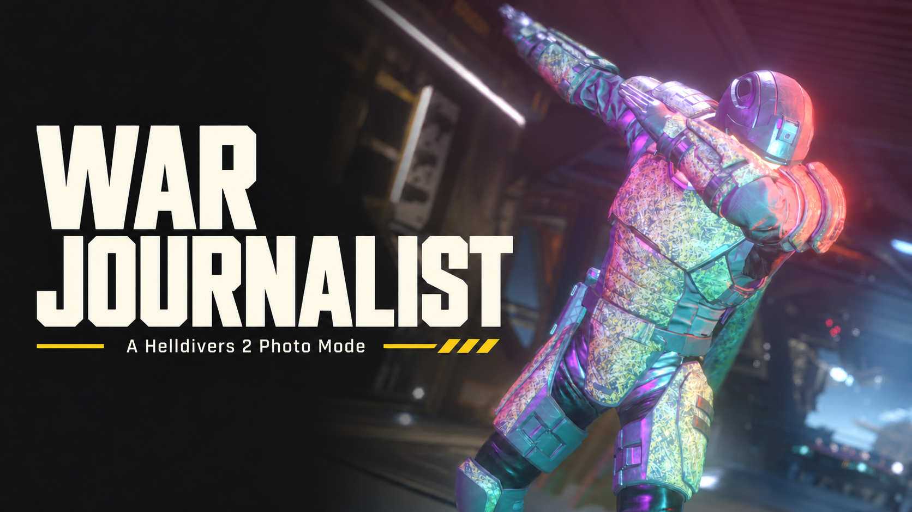

# War Journalist 1.4.0

Photo Mode for Helldivers 2: set up shots with a free camera, lighting,
poses, bone posing, camera paths and a first-person Handycam.

**[Download War Journalist 1.4.0](https://github.com/HWG90/DBF_PhotoMode/releases/tag/v1.4.0)**: one ZIP for both Boot Mod Loader and Chef's Shared Loader, so there's only one file to get. This is still the first pass of a full rewrite, so not everything from the old version is back yet. Import the ZIP into HD2 Arsenal, make sure War Journalist is switched on, Deploy with the game closed, then start the game. Nothing else to install.

**New in 1.4.0:** pose your Helldiver bone by bone in the Subject tab, and save up to 99 poses to load again later. The same ZIP now runs on Chef's Shared Loader 1.4.0 or newer as well as Boot Mod Loader. The helper that War Journalist starts on Windows is now called `war_journalist_helper.exe`, shows its name and version in its file details, and stays the same file across game updates; this follows a Windows Defender false alarm on 1.3.3. Center auto-focus works as intended now. See the [1.4.0 notes](docs/RELEASE-1.4.0.md).

**New in 1.3.3:** works with the 29 October 2026 game update, Pose Stop works again, Handycam is now on Page Down so Steam's Ctrl+F11 recording works, Saved Shots work, the camera comes back where you left it, and new Follow player cameras. See the [1.3.3 notes](docs/RELEASE-1.3.3.md).

## Your first shot

1. On the ship, press **P** (or your Photo Mode binding). Press **Tab** to move the camera and **Tab** again to use the panel.
2. Frame the shot. Press **Pause** to capture, then **P** to return. The Controls tab shows your current bindings.
3. For a pose, freeze while standing still, open **Subject**, press **Refresh**, and select your Helldiver. Choose a pose and press **Apply**. On Chef use camera keys that aren't also bound to gameplay movement.

For a moving shot open **Director**, choose a Follow mode and press **Begin action shot**. Pivot turns toward the subject. Pin travels with it. Follow look turns with the Helldiver's head. For an FRV, choose **Pin to picked part**, double-click near the desired attachment point on the visible vehicle, place the camera and begin the shot. Surface picking requires depth support.

## What's in it

War Journalist runs on [Boot Mod Loader](https://github.com/pat-pat-patrick/boot-mod-loader) or [Chef's Shared Loader](https://www.nexusmods.com/helldivers2/mods/17760) 1.4.0 or newer. With Boot Mod Loader on Windows, the included helper (WJL) starts on its own and stops your keys and mouse from moving your Helldiver while Photo Mode is open.
You get the free camera and menu, lens controls, subject picking, separate Hide options, screenshots, Freeze and Resume, slow motion, poses and bone posing, lighting and Handycam.

- The menu shows your game's Toggle HUD key, and warns you if it isn't set.
  That key still works while the Photo menu or a frozen camera is open.
- Apply Pose resets the last pose first. Picking a different pose while one is
  playing switches to it straight away.

See the [1.3.0 changelog](docs/RELEASE-1.3.0.md) and the
[known issues](docs/KNOWN-ISSUES.md) for what works and what still needs testing.

## Known limits

Subject picking and hiding every piece of gear still need work.
The cape can come loose, and ragdolls can act up now and then. Freezing someone on a
hoverpack isn't perfect. Handycam turning and aim can be slightly off, and the game's
own map markers can drift. On Windows, War Journalist can't hide the HUD for you;
use the game's own Toggle HUD key. AI control is gone for now.
Native camera DoF works, including focus and aperture. Inverted depth, Thermal depth, Depth contours, Depth fog and Shader DoF are removed because depth shaders don't work right now. Menu options that can't be used are hidden.

## Chef's Shared Loader

The same ZIP runs on Chef's Shared Loader 1.4.0 or newer, but it's more limited there. Chef can't start the helper, so **your keys still reach the game while Photo Mode is open** and **screenshots are DDS files** in the game's settings folder, not PNG. P opens Photo Mode, the arrow keys move the camera and the panel, and Shift with Left or Right changes tabs. Use Chef 1.5.1 or newer for double-click focus and Center auto-focus. If you have both loaders, War Journalist still runs only once.

## Development

See [BUILD.md](BUILD.md) for source checks and build entrypoints. Runtime source,
fixtures and builders live in `freecam/` and `tools/`. Local packages and test
output belong under `dist/` and are excluded from Git.

Defunct BSL, MDL and earlier LLL entrypoints, release tooling and historical
records are retained in [archive/](archive/README.md). Shared models still used
by the current runtime or fixtures remain in the active source tree.

Artwork credits, third-party licenses and asset provenance remain with their
respective source files and manifests.
