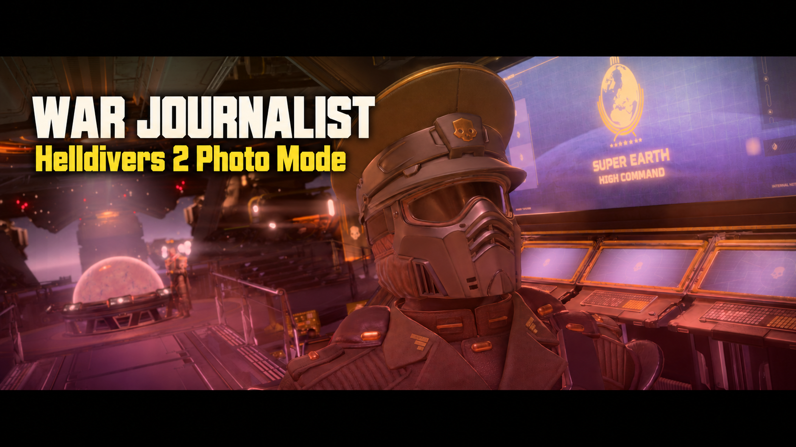

# War Journalist 0.9.5

A Photo Mode for Helldivers 2: free camera, a compact movable studio menu,
Native and shader depth of field, autofocus, color grading, scene effects,
photo lighting, Director camera presets, subject visibility and PNG capture.

[Download on Nexus](https://www.nexusmods.com/helldivers2/mods/17248?tab=files) ·
[GitHub downloads](https://github.com/HWG90/DBF_PhotoMode/releases/tag/v0.9.5) ·
[Full 0.9.5 changelog](docs/RELEASE-0.9.5.md)

## What's new

- **Native focus and aperture**, with current-camera discovery and lifecycle guards.
- **Double-click focus and center autofocus**, lens presets and fine focus adjustment.
- **Full-resolution compositor**: scene color/depth effects and shader bokeh work together.
- **Movable, resizable menu** that remembers its position, contextual docked controls, and precise Shift scrubbing.
- **Director**: five saved camera angles/positions relative to the player.
- **Photo lights**: up to three point/spot lights, placement indicators, colors, power and range controls. The new mission light asset fix is **Not tested fully**.
- **Subject visibility**, a rebindable screenshot key (Pause by default), and curated Helldivers/Super Earth logos.
- Fixes for screenshot color channels/HDR conversion, menu reopening, chat keybind conflicts, missing animation graphs, camera instances and the reported hoverpack/melee pause crash.

## Install

Choose one loader: **BSL v15+** (recommended), **MDL API 2**, or **LLL**.
Nexus hosts BSL and MDL; GitHub hosts all three. Every ZIP includes the complete
runtime and its required assets. No separate asset download is needed.
MCM, DBF-HUD, ActionCam and Link's addon are not prerequisites.

BSL: import the complete ZIP in Arsenal, enable with BSL, deploy and restart.
MDL/LLL: install the included `dbf_freecam` folder in the loader's Mods folder,
deploy the asset ZIP bundled inside that same download, and restart.
Use one Photo Mode runtime at a time. Preserve settings, presets and screenshots.
See [installation and controls](freecam/README.md) for manual installation.

## Controls

P opens Photo Mode; Tab switches camera/menu focus; Pause takes a screenshot.
W/S navigates rows and A/D changes values in menu focus; Q/E changes tabs.
Double-click a subject outside the menu to focus. Hold Shift while dragging
sliders for finer adjustment. Typed values commit when clicking away.
All key bindings are configurable; existing bindings are retained.

Native DoF is the quality baseline. Shader DoF offers round/hex bokeh and
32/64-sample quality. Scene effects and grading can layer with shader DoF.
The compositor's HDR tint/exposure correction was visually accepted;
SDR compositor parity and all effect combinations are not fully validated.
Pause/slow motion are solo-only. See [known issues](docs/KNOWN-ISSUES.md).

## Build and verification

Use `py -3 tools/build_release.py --output dist/releases/<new-folder>`.
The builder uses maintained source and hash-checked compiled asset snapshots;
no installed-game assets or developer capture folders are needed. Lua syntax
validation requires a Lua 5.1/LuaJIT DLL (`HD2_LUA51_DLL` can select it).
Run `py -3 tools/run_tests.py` for isolated fixtures and
`py -3 tools/test_packaged_standalone.py <BSL.zip> <MDL.zip> <LLL.zip>` for
source-independent package startup checks. Tests do not establish live GPU behavior.

## Credits

Camera foundation: [ActionCam](https://www.nexusmods.com/helldivers2/mods/16752)
by HuedPurple. Native UI/font reader: CowboyBingus (0BSD). Selected reader
work: Link (MIT). Bundled licenses and vendor provenance identify their scope.
Helldivers 2/Arrowhead artwork belongs to its respective owners; individual
logo sources and authors are recorded under `freecam/assets/logos`.
