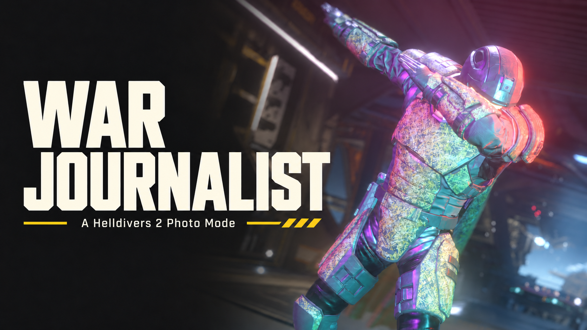

# War Journalist 1.3.1

Photo Mode for Helldivers 2: compose shots with a free camera, lighting,
subject poses, camera paths and first-person Handycam.

**[Download War Journalist 1.3.1 for Boot Mod Loader](https://github.com/HWG90/DBF_PhotoMode/releases/tag/v1.3.1).** This is the first pass of a total Lua rewrite with incomplete parity. Import the complete ZIP into HD2 Arsenal, enable War Journalist and Assets, deploy with the game closed, then launch normally. No manual helper or Python setup is required.

**New in 1.3.1:** Photo Mode no longer flashes and closes on Windows when another program (for example a GPU overlay) owns one of its Ctrl/Shift/Alt shortcuts, WJL now starts without PowerShell, so Photo Mode opens under Proton again, and the cursor stays inside the game window while Photo Mode has it. See the [1.3.1 notes](docs/RELEASE-1.3.1.md).

## Current runtime

The Lua 5.1 rewrite targets [Boot Mod Loader](https://github.com/pat-pat-patrick/boot-mod-loader). The Windows WJL helper starts
automatically and provides keyboard/mouse isolation while Photo Mode owns input.
The source includes the camera and menu improvements, native lens controls,
subject selection, independent visibility options, screenshots, Freeze/Resume,
slow motion, lighting, and Handycam ADS handoffs.

- The menu displays your game's Toggle HUD binding and warns if it is unbound.
  That key remains available while the Photo menu or frozen camera owns input.
- Apply Pose resets the previous pose first. Changing an already-held pose resets
  and applies the new selection automatically.
- Retained menu geometry, cached font metrics and event-driven state changes keep
  unchanged controls idle. Camera and cleanup ownership checks remain mandatory.

See the [1.3.0 changelog](docs/RELEASE-1.3.0.md) and
[known issues](docs/KNOWN-ISSUES.md) for supported behavior and testing limits.

## Current limitations

Subject selection and complete equipment hiding still need broader coverage.
Cape detachment and rare ragdoll issues remain. Hoverpack pause uses a near-zero
fallback. Handycam body turning, aim parallax, and drifting native world HUD
markers remain unresolved. Automatic native HUD hiding is unavailable on Windows;
use the game's own Toggle HUD binding. Enemy AI controls are unavailable.
Native camera DoF works, including focus and aperture. Inverted depth, Thermal depth, Depth contours, Depth fog and Shader DoF are removed because depth shaders do not currently work. Unavailable controls are omitted from the normal-user menu; developer reload, inventories and test activations are disabled.

## Chef preview

Boot Mod Loader is the only supported loader at present. A Lite version for Chef's Shared Loader is planned. Whitelist approval may permit fuller compatibility; neither approval nor full compatibility is guaranteed.

## Development

See [BUILD.md](BUILD.md) for source checks and build entrypoints. Runtime source,
fixtures and builders live in `freecam/` and `tools/`. Local packages and test
output belong under `dist/` and are excluded from Git.

Defunct BSL, MDL and earlier LLL entrypoints, release tooling and historical
records are retained in [archive/](archive/README.md). Shared models still used
by the current runtime or fixtures remain in the active source tree.

Artwork credits, third-party licenses and asset provenance remain with their
respective source files and manifests.
