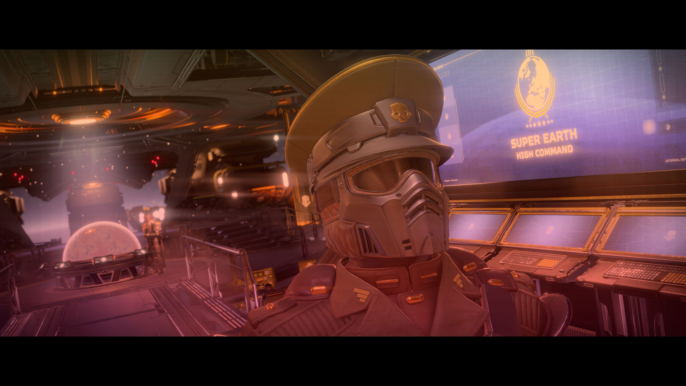
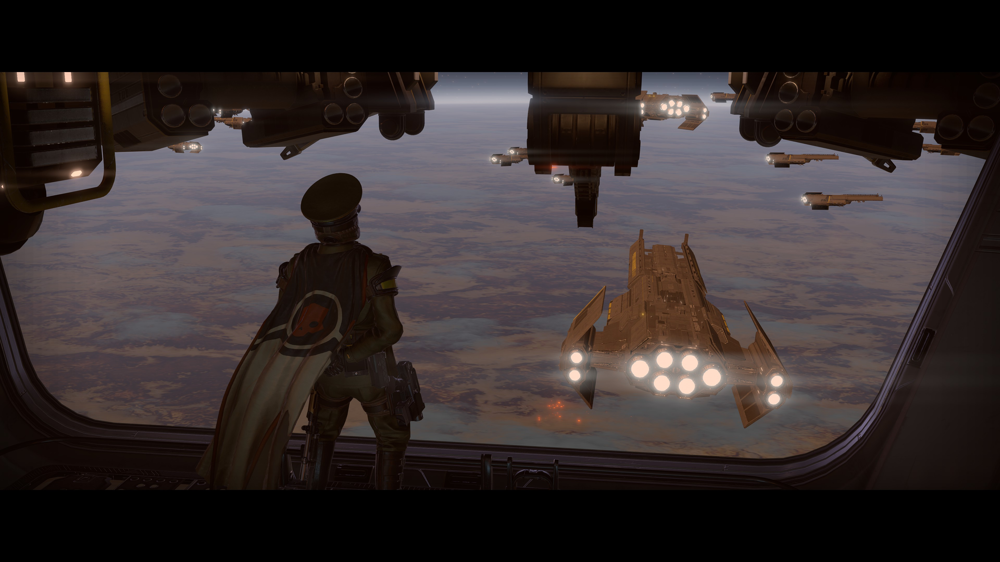
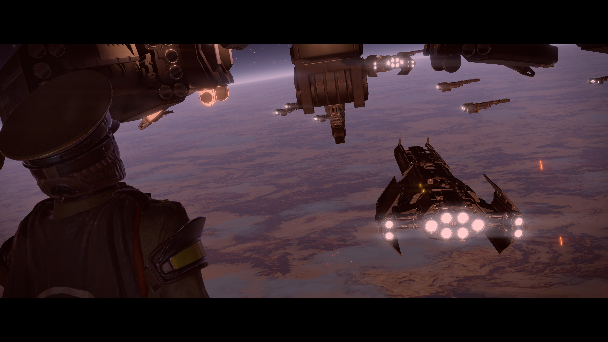
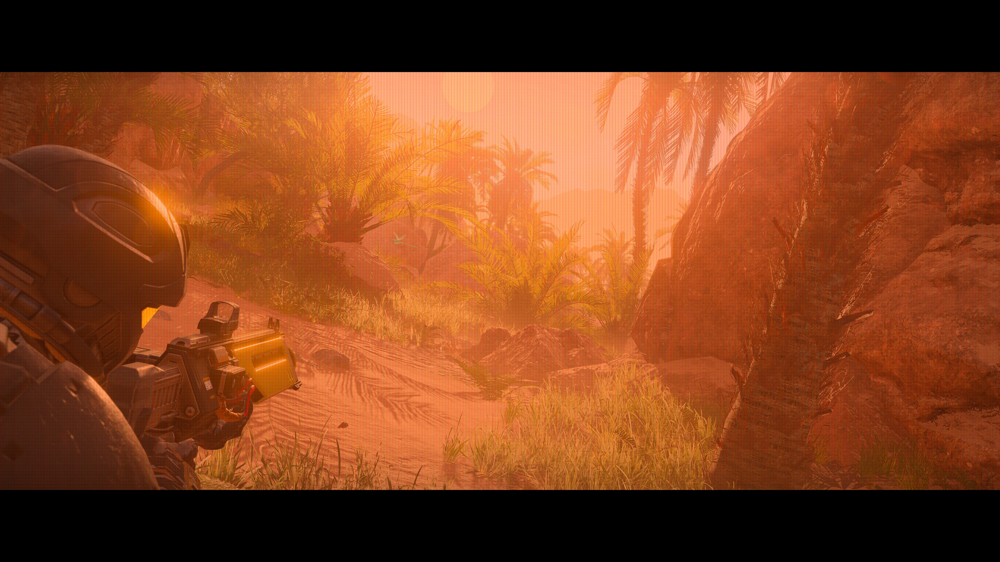
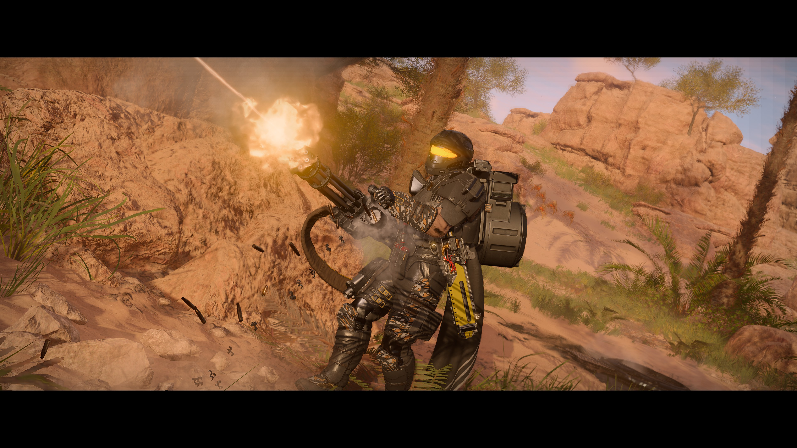
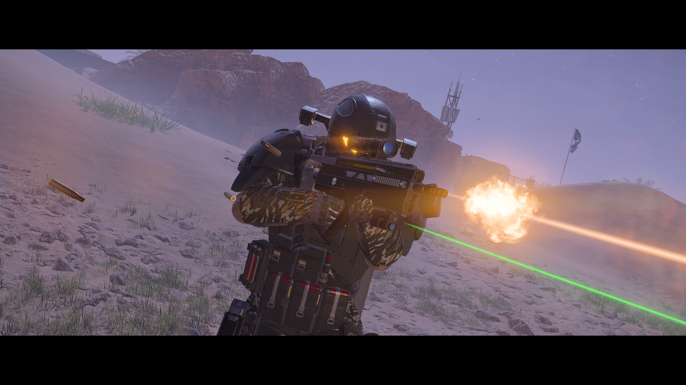
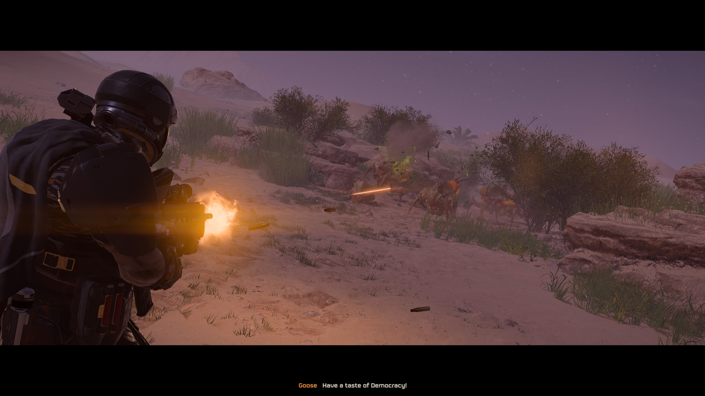
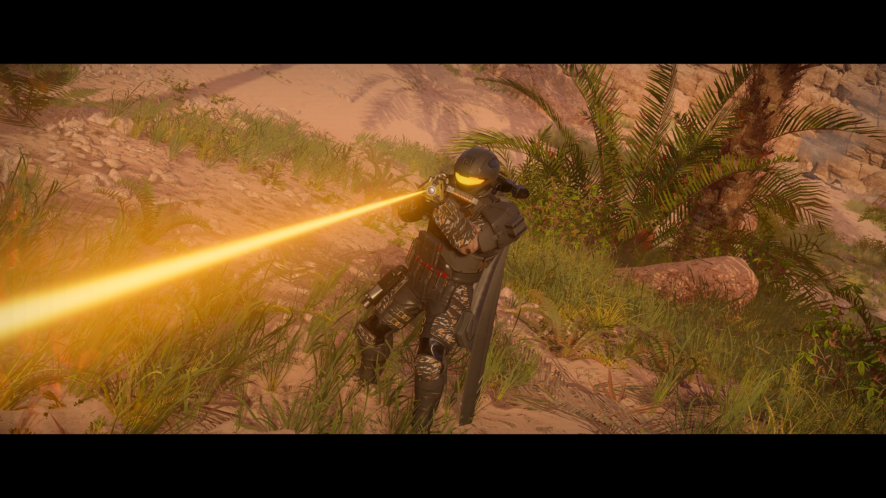

War Journalist - Helldivers 2 Photo Mode

0.7 Preview

NOTICE: When Shader DoF is enabled, scene effects and color controls are grayed out.
The menu displays "Shader DoF Enabled. Scene Effects disabled".
Turn DoF OFF or select Native camera mode to use scene effects.

BSL is the recommended main download and requires only Bingus Shared Loader
v15 or newer. The ZIP includes the camera, private menu/input, PNG capture,
40 decorative shader overlays, shader DoF, and scene preview assets. MCM, DBF-HUD and ActionCam downloads
are not required. HD2 Arsenal is an optional way to install the BSL ZIP;
enable it alongside BSL, deploy, then restart normally. MDL API 2 is the
alternative loader; its ZIP includes both the loose addon and GameData assets. Install only one Photo Mode package.
MCM is optional. With MCM, configure Photo Mode there; without it, use the
photo menu Controls page. Disable the original ActionCam before installing.
If an older incompatible MCM is installed, disable or update it before using
Photo Mode; its existing input owner is never replaced by this addon.

MANUAL ASSET INSTALL (NO MOD MANAGER REQUIRED)
With the game closed, copy the included patch files from Addon (BSL) or
GameData (MDL) into Helldivers 2/data. For each archive base, rename patch_0
to the next unused patch_N after existing patches, using the same N for its
.patch_N, .patch_N.gpu_resources and .patch_N.stream files. Preserve the
9ba626afa44a3aa3 and ee6b1ba7e22d71ed base names. Never overwrite another
mod. Restart normally. MDL users must also copy dbf_freecam into
%LOCALAPPDATA%/MDL/Helldivers2/Mods and enable it in MDL.
Settings for standalone controls use %LOCALAPPDATA%/DBF/PhotoMode/settings.
To remove the manual installation, remove only the patch triplets you added
and the loose addon folder (MDL). Other mods replacing the default shader
registry can conflict; merge the registrations when combining shader packs.

P: photo mode. WASD: move. Shift/Ctrl: rise/descend. Mousewheel: speed.
Q/E: roll in camera focus, tabs in menu focus. Tab: camera/menu focus.
In menu focus W/S selects rows; A/D adjusts values or cycles choices without hover.
Shift+A/D gives 0.001 m focus steps. Valid typed values also save on leaving the field.
L: lock/unlock the camera. Backslash: prototype slow motion (solo).
H: hide controls. Enter/Space: choose/edit. Escape: cancel/leave.
All bindings are configurable. Resizing the menu scales its text and controls.
Click a numeric value or press Enter/Space to type. Enter/Space saves, Escape
cancels, and right-click resets an enabled setting to its default.

Save Camera Position retains the shot while you stay within its configured
5-60 m radius. Leaving the radius, returning to the player, changing scenes,
death or restarting clears it. Saved positions last for this session only.

Solo mode pauses native player animation and simulation/AI. The native DLL
refuses pause and slow motion with other/joining players or unknown state.
Freecam can still work in multiplayer. Focus loss keeps the solo pause.

BSL screenshots are saved in `%LOCALAPPDATA%/DBF/PhotoMode/Screenshots`.
The MDL package uses its mod folder's `Screenshots` directory. Capture temporarily hides
photo controls and requesting game HUD hiding, then restoring your settings.
Use Steam screenshots as an alternative.

SHADER DOF / PREVIEW LIMITS
Choose Shader preview for working depth-aware focus distance and aperture/f-stop.
32/64 samples and round/hex bokeh are available. Blur uses a 960x540 color source;
focused pixels retain the original full-resolution scene. Final bokeh quality
remains under review. All 42 shader libraries, 42 materials and 317 registry IDs
are bundled; no separate DoF asset package is required.

Native game engine DoF is still nonfunctional for manual focus/aperture control;
its numeric controls remain disabled. The native toggle uses the game's existing
effect and does not implement an adjustable lens.

Scene color/depth effects and exposure/contrast/saturation are included as
unverified previews. They are gated while Shader DoF is ON; turn DoF OFF or select
native camera mode to test them. Scene color uses a 960x540 source; neutral
controls preserve the original image. HDR-aware PNG conversion is included,
but ship UI may remain visible. Steam screenshots remain an alternative.
Disable older Photo Mode packages, the LLL addon, and any separate DoF asset
candidate. Only BSL and MDL are offered in 0.7. No alt-tab crash fix is claimed.

CREDITS
Camera discovery/photo foundation: [ActionCam](https://www.nexusmods.com/helldivers2/mods/16752) by HuedPurple.
Bingus native UI/font reader: CowboyBingus (0BSD, included license).
Helldivers 2 and Arrowhead artwork remains property of its respective owners.

[Source and GitHub downloads](https://github.com/HWG90/DBF_PhotoMode) |
[Nexus](https://www.nexusmods.com/helldivers2/mods/17248) |
[Ayaka](https://ayakamods.com/mods/war-journalist-helldivers-2-photo-mode.4948/)

## Gallery

