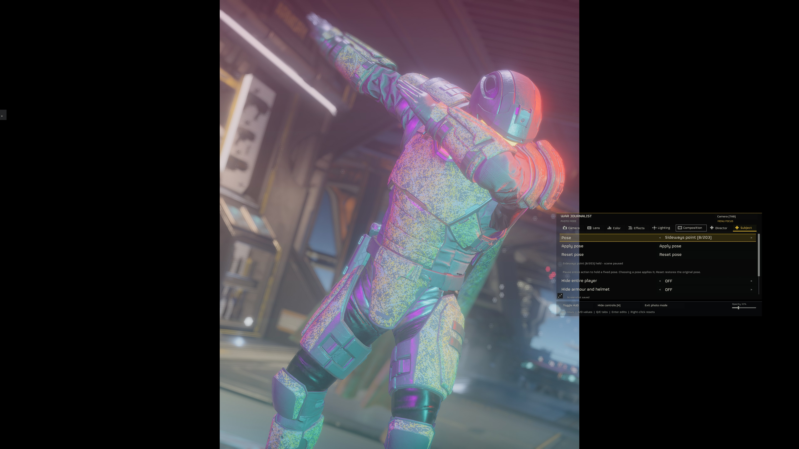
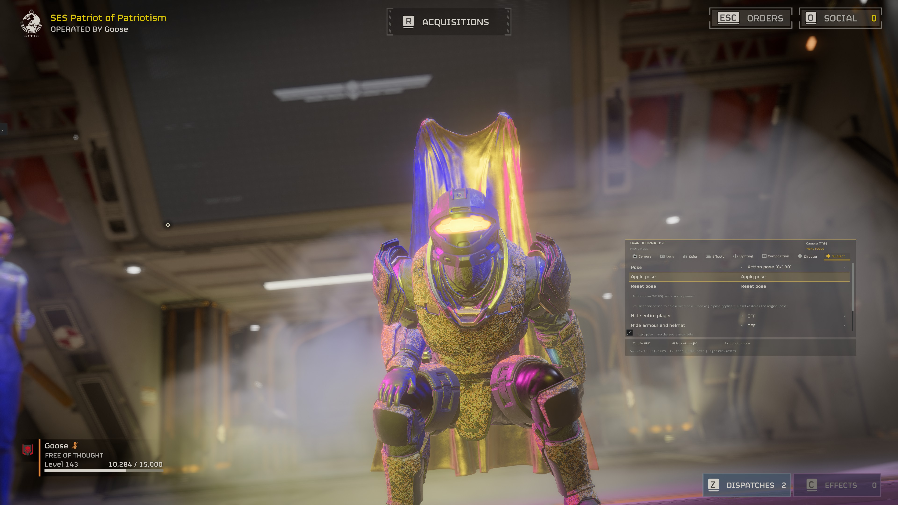

# War Journalist 0.9.7

Pose your Helldiver without unpausing the scene. Move your lights into place,
save the setup, and keep enemies out of the shot. This release brings all the
changes since public **0.9.5** together.

## New tools

- **213 fixed pose frames:** select a pose in Subject while **Pause entire action** is ON. Salutes, gestures, cooperative variants, kneeling poses and both push-ups apply immediately while world time stays at zero. **Reset pose** restores your original pose. These are sampled emote/action frames, **not 213 store emotes**; see the [pose catalogue](SUBJECT-POSE-CATALOGUE.md).
- **Solo enemy behavior:** Director now offers **Normal**, **Passive**, **Dummy**, and **Reset AI to Normal**. Your selection stays active after leaving Photo Mode and covers newly discovered enemies. Passive suppresses detection; Dummy also restricts ordinary movement. Joining players cancel the mode and restore owned changes. A game restart returns to Normal. No Link addon is required.
- **Light placement tools:** numbered, color-coded indicators let you select and drag lights through the scene. Hold Shift for finer movement. Aim a light at your subject, or apply **Key / Fill / Rim**, **Portrait**, or **Dramatic side** lighting. Indicators hide with the controls and clean screenshots.
- **Five saved lighting setups:** save and recall placements relative to your subject, including color and other light settings. Slots survive restarts. Reopening Photo Mode in the same scene also restores the setup you were using.
- **Stronger shader DoF:** blur strength ranges from **1x to 8x**, with 4x as the default. Above 1x, Standard uses 64 samples and Smoother uses 128. The previously accepted compositor color conversion is retained; Native remains the blur-quality baseline.
- **Adjustable menu opacity:** a compact slider in the bottom-right footer changes the menu background from 10% to 100%. It saves across restarts; right-click restores 38%.
- **Clearer color editing:** an explicit **Apply** button, a live color swatch, and a HEX readout stay visible while adjusting RGB.

*A pose selected with the scene paused. Screenshot supplied by David, unchanged.*

## Bugs fixed

- **Floating cape during pose changes — FIXED for supported capes.** The original cape now follows the posed shoulders and restores when you reset, switch poses, or leave. Its textures and frozen cloth shape are preserved, without advancing physics. The integrated fix was confirmed while switching between a push-up and Salute at zero world time.
- **Poses stuck grayed out after pausing:** readiness now responds immediately to pause changes and retries against real time instead of waiting for stopped simulation time.
- **Pose cleanup before resuming:** Reset, Photo Mode exit, pause-off, and slow motion restore owned pose changes before gameplay resumes. Temporary cleanup failures retain a retry instead of losing the original state.
- **Enemy behavior dropping during scene/respawn reads:** temporary scene loss suspends changes without forgetting your selection. Dummy also renews its owned movement restriction when a borrowed detector is temporarily unavailable.
- **Enemies staying hostile in Passive or Dummy:** a stale borrowed detector owner no longer blocks the enemy's valid controls. Both modes were confirmed working after the fix. Known enemies are refreshed in bounded batches each update, with independent component handling and retryable cleanup; a discovery fault no longer stops their hold.
- **Lights lost when reopening Photo Mode:** placements are restored in the same scene, so you do not have to add them again.
- **Equipment left floating when hiding the player:** visibility controls now include nested equipment.
- **Cleanup interrupted by a menu-close error:** the remaining effect, time and input cleanup still runs; GUI teardown also checks world lifetime.
- **MDL installation:** the complete package has no nested archives. Copy the runtime into MDL's Mods folder and deploy the included GameData through Arsenal.

**FIXED — before-fix screenshot.** This image shows the old floating-cape bug,
not the corrected result. Supported capes now follow the posed shoulders.

## Test scope and remaining limits

All **53 isolated fixture groups passed**, including application, holding,
switching and restoration of all 213 pose frames. In-game checks confirmed
selected poses, both push-ups, Reset, the integrated cape correction, and
enemy-behavior persistence/Reset. These checks do not establish every pose,
cape, mission, camera transition or release-package cold startup.

**Lighting: Not tested fully.** Broader mission coverage, draggable lights and
saved lighting setups still need fresh live acceptance. The stronger shader
blur also needs visual acceptance. Large foreground blur, HDR highlights above
the GUI carrier's white level, SDR compositor parity and some effect
combinations remain limitations or open checks.

Fixed poses require solo pause. They do not spawn props or another participant.
Unidentified clips retain development labels. The cape correction preserves
the existing cloth shape; it does not simulate a new drape. Unsupported cape
classes skip the correction while body poses remain available.

Passive and Dummy do not stop AI processing, physics, damage or attacks already
in progress. They require verified solo mission authority. **HDR/SDR switching
and other display-setting crashes remain unresolved.** See [known issues](KNOWN-ISSUES.md).

## Install

Choose one complete **BSL v15+**, **MDL API 2**, or **LLL** package. Every download
includes its runtime and required assets. Nexus offers BSL and MDL; GitHub
offers all three. MCM, DBF-HUD, ActionCam and Link's addon are not prerequisites.

Follow the package's `INSTALL.txt`, deploy its included assets, and restart.
Keep only one Photo Mode runtime active. Preserve your settings, camera and
lighting presets, and screenshots. Existing key bindings remain unchanged.

Native/shader DoF, autofocus, the combined compositor, Director camera shots,
curated logos and the earlier crash/input/screenshot fixes remain included;
see the [0.9.5 notes](RELEASE-0.9.5.md) for their original test scope.
