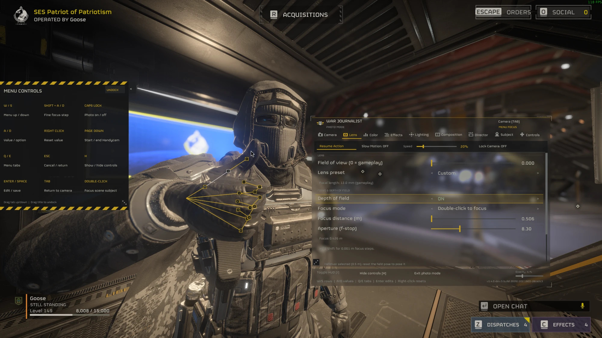

# War Journalist 1.4.0 — Bone posing and Chef's Shared Loader

Stop the action. Find your angle. Build the shot.

**A HUGE THANK YOU to everyone sharing photos, testing builds and reporting bugs.** Thanks to **JuanHalodiver** for reporting the Windows Defender warning, and to **Chefbo** for the Chef's Shared Loader features War Journalist now uses. Keep the shots coming!

**One download for both loaders.** The same ZIP works with **Boot Mod Loader** and with **Chef's Shared Loader** 1.4.0 or newer. There's no separate Chef version to pick: whichever loader you use, this is the only file you need.

1.4.0 also lets you pose your Helldiver bone by bone and save your poses. The Windows helper has a new name, and Center auto-focus works as intended now.

## New

- **Bone posing.** Freeze your Helldiver, then open **Pose editor** in the Subject tab. Pick a body part and a bone, then turn it with the Bend, Swing and Twist sliders, or drag it on screen:
  - rings mark the bones; click one to pick it;
  - left drag swings the bone so its ring follows your mouse;
  - right drag bends and swings it, middle drag twists it, the mouse wheel pushes it nearer or further;
  - hold Shift for small steps.

  Start from any of the 213 poses, or from the way your Helldiver is standing. Picking another pose clears your edits.

  
- **Saved poses.** Save the pose you see and load it again later, even after restarting the game. You can keep up to 99, as `wj-pose-01.txt` to `wj-pose-99.txt` next to your settings. To use a friend's pose, copy their file in under a free number and press Rescan.
- **Your edits stay** when you close and reopen Photo Mode. Reset pose clears them.
- **One ZIP for Boot Mod Loader and Chef's Shared Loader.** If you have both loaders, War Journalist still runs only once. Chef works differently, so please read the next section if you use it.

## On Chef's Shared Loader: read this first

War Journalist on Chef is more limited than on Boot Mod Loader:

- **No helper.** Chef doesn't let mods start programs, so the helper that Boot Mod Loader uses can't run. That means:
  - **your keys still reach the game while Photo Mode is open**, which is why the camera moves with the arrow keys instead of W/A/S/D;
  - **screenshots are DDS files, not PNG.** They're saved in the game's settings folder (`%APPDATA%\Arrowhead\Helldivers2`). Open them with an image viewer that reads DDS, or convert them.
- **Double-click focus and Center auto-focus need Chef 1.5.1 or newer.** On older versions, use Manual focus.
- **War Journalist needs Chef 1.4.0 or newer.** On older versions it stays off.
- Keys: P opens Photo Mode, the arrow keys move the camera and the panel, and Shift with Left or Right changes tabs. Change keys in F9 > War Journalist or in the panel.

## Changed

- **The Windows helper has a new name:** `war_journalist_helper.exe`. The old `wjl_steam_service.exe` is deleted when the game starts. Windows Defender quarantined the 1.3.3 helper for one player. It was a false alarm, but the new helper is easier for Windows to recognise:
  - its file details show War Journalist, HWG90 and a version number;
  - it stays the same file across game updates, so Windows doesn't see a new, unknown file after every update;
  - it no longer hides the small files it makes while saving a screenshot.
- **Center auto-focus works as intended now.** A Helldiver in the middle of the screen stays in focus as you move, and scenery comes into focus when the camera stops.
- **One option in HD2 Arsenal.** It's now called "War Journalist" and includes the assets. Your keys, settings, presets and screenshots carry over from 1.3.3.

Windows may still warn about the new helper until Microsoft has reviewed it. If Defender flags it, please tell me and include the name it shows.

All the known bugs from 1.3.3 are still there: the cape sometimes comes loose, picking a subject sometimes fails, some Hide options miss things, AI control is gone for now, and depth shaders don't work (Native DoF does). See the [known issues](https://github.com/HWG90/DBF_PhotoMode/blob/main/docs/KNOWN-ISSUES.md).

## Install

Import the ZIP into HD2 Arsenal and make sure **War Journalist** is switched on. It's the same ZIP for [Boot Mod Loader](https://www.nexusmods.com/helldivers2/mods/17754) and [Chef's Shared Loader](https://www.nexusmods.com/helldivers2/mods/17760) 1.4.0 or newer. Deploy with the game closed, then start the game.

It replaces 1.3.3. If you tried a Chef test build of War Journalist, switch that one off too, so only one copy runs. You need the 29 October game update.

Developed on Linux via Proton.

## Reporting bugs

Tell me your loader and its version, and send these files from `%APPDATA%\Arrowhead\Helldivers2\`, with anything private removed:

- Boot Mod Loader: `boot_mod_loader.log`, `war_journalist_lua51.log`, and `%LOCALAPPDATA%\WJL\Helldivers2\Steam\service.log`
- Chef's Shared Loader: `chef_loader.log` and `war_journalist_chef.log`
